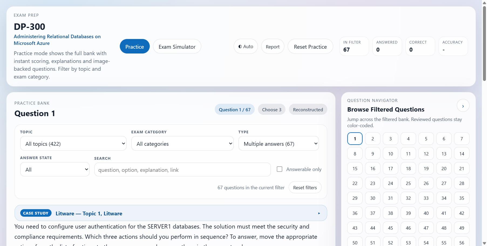

# DP-300 Exam Prep

A browser-based practice bank and exam simulator for **Microsoft DP-300 —
Administering Relational Databases on Microsoft Azure**.

The question bank is extracted from the source PDF and shipped as static
JSON, so the whole app runs in the browser with no server, no build step
and no dependencies.

## What is in here

```
index.html                       the app shell
assets/styles.css                design system
assets/app.js                    application logic
sw.js                            service worker (offline support)
questions.json                   the extracted question bank
extracted_images/                246 images referenced by the bank (246 in the folder)
tests/                           the test suite (node --test, no dependencies)
```

`questions.json` has three top-level collections:

| Collection   | Purpose |
| ------------ | ------- |
| `metadata`   | Topic and exam-category enumerations, counts and verification tables |
| `scenarios`  | The three case studies, stored **once** each and split into sections |
| `questions`  | The 422-question bank |

Questions in a case study do not repeat the narrative. Each one carries a
`scenario_id` and a hyperlink-ready `scenario_ref`:

```json
"scenario_id": "scenario_t1_litware",
"scenario_ref": {
  "id": "scenario_t1_litware",
  "href": "#scenario_t1_litware",
  "title": "Litware",
  "topic_index": 1
}
```

## Modes

### Practice

Filter the whole bank by **topic**, **exam category**, **question type**,
**answer state** and free text, or tick *Answerable only* to hide diagram
questions. Single-answer questions are scored the moment you click; multi-answer
questions need **Check Answer**. The explanation and the source references are
one click away, and the navigator grid keeps every question you have reviewed
colour-coded.

The **type** filter names the four shapes the bank is built from, and the count
on each one is the count in the bank:

| Type | Count | What the student does |
| --- | --- | --- |
| **Single answer** | 219 | Picks one option. |
| **Multiple answers** | 67 | Picks several; the question says how many. |
| **Answer per statement** | 114 | Answers each statement on its own - every statement has to be right. |
| **Lab task** | 22 | A hands-on walk-through; there is no answer to mark. |

These are the exam's own words for the two multiple-choice shapes. They used to
be both called *Multiple choice*, which left the filter showing two entries with
the same name and different counts.



Below the filters sits the **progress report**, which answers the question the
app used to leave open: *what am I actually bad at?* See
[Study tools](#study-tools) below.

### Exam Simulator

60 questions in 120 minutes, built to mirror the real paper:

1. **1–2 random case studies**, taking *every* question in each one.
2. **Lab tasks** from Topic 5.
3. The remainder from **Topic 6**.

The blueprint panel shows the exact composition before you start, and the
plan previewed there is the paper you get. A case study is taken whole, so
the simulator only chooses as many as fit in the paper you asked for — and
the preview says so. Answers stay hidden until you submit or the timer
expires; flagged questions are marked in the navigator.
On submission you get a score, a breakdown by topic and by exam category, and
a full question-by-question review.

## Grading

Only questions that have both a published answer key *and* visible option
text can be scored. In this source that is **400 of 422** questions. The
other 22 are lab tasks: the answer is a walk-through, not a multiple-choice
key, so there is nothing to mark.

The app never pretends otherwise: the results screen reports the score over
the graded questions and states how many could not be scored, and ungraded
questions are marked as such in the navigator.

## The navigator panel

The question/exam navigator on the right can be collapsed with the chevron
button in its header. On a desktop screen it folds into a slim vertical rail
that still shows the word *Navigator*, so the question pane gets the full
width. Below 1080px the layout is a single column and the toggle only folds
the question grid away, keeping the panel heading visible.

The choice is remembered in `localStorage` under `dp300.ui.v1` and is restored
before the first paint, so a reload never flashes the expanded layout.
Submitting an exam re-opens the panel automatically, because that is where
the score appears.

The 422 chips are built **once** per visible set of questions and then
repainted, rather than being rebuilt and re-wired on every navigation, and
one delegated listener on the grid serves all of them.

## Mobile layout

Below 820px the exam simulator becomes a thumb-first single column:

- **Sticky header** – the wordmark, the mode switch, the live timer and the
  action button stay on screen while the question scrolls under them.
- **Fixed action bar** – *Previous* and *Next* are pinned to the bottom of
  the viewport, so a question can be navigated without scrolling back up.
  The secondary actions (Clear, Flag, Check answer, Explanation) sit in a
  scrollable row just above it.
- **Navigator as a bottom sheet** – the ☰ button slides the question grid up
  from the bottom over a dimmed page. Tapping a number jumps to that question
  and dismisses the sheet; ✕, the backdrop and `Esc` close it.
- **Compact blueprint** – the four simulator settings collapse into
  label-on-the-left, control-on-the-right rows.

Landscape phones (short viewports) keep the two-column layout but get a
one-row header so it does not eat the screen.

The timer moved from the question toolbar into the header, which keeps it
visible on every screen size while an exam is running. It warns at **10
minutes** and **5 minutes**, and at **1 minute** the warning next to it
carries a **Submit now** button, so the exam is submitted on purpose rather
than by the clock. The clock reads a wall-clock deadline rather than counting
down, so a backgrounded tab cannot gain time.

## Keyboard

A bank of 422 questions is a lot to click through, so the common actions are
on the keyboard. The hint under each question lists the shortcuts that apply
to the question on screen.

| Key | Action |
| --- | --- |
| `A` `B` `C` `D` | pick the option with that letter |
| `E` | show or hide the explanation |
| `F` | flag the question for review (exam mode) |
| `←` `→` | previous / next question |
| `Ctrl` + `←` `→` | previous / next question, when the plain arrows are taken by a focused control |
| `Esc` | close the navigator sheet |

Only A to D pick an option: the bank has options labelled E and beyond, and
E and F are the explanation and the flag, so a question with an option E would
otherwise have two meanings for one key. The hint names the options that need
a click. On a per-statement question a letter goes to the first statement that
has not been answered yet, so the grid can be worked down without the mouse.

The explanation shortcut respects the same rule as the *See Explanation*
button: it cannot open an explanation the app is not ready to show.

## Study tools

Everything in this section works in the practice bank and persists in
`localStorage` under `dp300.practice.v1` or `dp300.filters.v1`.

### The progress report

The report sits under the filters and aggregates the practice results by
**exam category**, so it can answer *"what should I study on Monday?"*.

Each area is scored by the size of the gap multiplied by **the exam weight
the outline gives that area** (the outline publishes a range — "20–25% of the
exam" — and the midpoint is used when two areas have to be compared). A gap in
a category that is a quarter of the paper therefore outranks the same gap in
one that is a fifth of it.

The areas are listed worst-first, the weakest one is called out, and **Drill
<area>** opens that area and lands on the first question in it that was never
answered right. Every row is a button that drills into its own area.

An area needs **3 graded attempts** before it is judged — two answers do not
make a score. Until then it shows the raw count (`2/5 so far`) rather than a
percentage, and it is not eligible to be the weakest area.

### Answer-state filters

The **Answer state** filter narrows the bank by what you have done with a
question: **All**, **Unanswered only**, **Wrong only**, **Correct only**. The
counts on the control are live, so *Wrong only (12)* tells you how many
questions are waiting for you. Wrong and correct only count questions that
were actually scored: an attempt on a question with no published key is
recorded as answered, but it was never marked right or wrong.

### Search

The search box covers the question text, the option text, the statements on a
per-statement question, the explanation, the source references, and the topic
and category names — so a question can be found by what you remember about it,
not only by what the stem says.

Several words are combined with AND, so `geo replication` finds the questions
that mention both. Matches are highlighted in the question, in the options and
in the explanation. The box is debounced, because every keystroke would
otherwise rebuild the 422-chip navigator.

### Notes

Every question has a note box underneath it. The note is for you and your
instructor — *ask about this one* — and it is saved as you type, alongside the
practice results. A question that carries a note is marked with a blue dot in
the navigator, and the note is printed with the report and included in the CSV.

### Deep links

Every question has an address: `https://<site>/#q-306`. The address bar
follows the question on screen, so **Copy Link** copies a link to the question
in front of you. Opening a link jumps straight to that question, clearing the
filters first — a shared link means "show me this one", so it outranks whatever
filter the browser had remembered.

## Report and export

The **Report** button in the header opens a record of the session: the score,
the breakdown by exam category, and every question you attempted with your
answer, the correct answer, the verdict and any note you wrote.

- **Print / Save as PDF** builds a printable record — student name, date,
  mode, score, the category breakdown and the full question list — and prints
  it. A print stylesheet makes that record the only thing on the page.
- **Download CSV** exports the same rows as a spreadsheet, with the question
  text included, for a learning record or a spreadsheet.

The student name is remembered, so an instructor only types it once per
class. In the exam simulator the report lists the answered questions while the
exam runs, and every question in the paper once it has been submitted — the
ones left blank show up as gaps in the record.

## Offline use

The app registers a service worker (`sw.js`), so it keeps working without a
network connection — the point of a timed simulator is that it does not stop
halfway through on hotel wifi.

- The **shell** (the page, the CSS, the script and `questions.json`) is cached
  and served **network-first**: online you always get the current build, and
  offline you get the last one you used.
- The **images** are cached **as they are viewed**. The file names carry a
  content hash, so a cached image is always the right image. 34.6 MB of
  diagrams is never preloaded.

The footer says *Offline copy ready* once the worker is running, and says so
plainly when the connection has dropped.

## Dark mode

The theme control in the header cycles **Auto → Light → Dark**. *Auto* follows
the operating system's `prefers-color-scheme` and updates while the page is
open; the choice is remembered in `localStorage` under `dp300.theme.v1`.

Every colour in `styles.css` is composed from a set of tokens, so the dark
theme is a token swap rather than a second stylesheet. An inline script in the
head of the page sets the theme before the first paint, so a student on a dark
desktop never gets a white flash.

## Accessibility

- The verdict is announced: the feedback banner is a `role="status"`
  `aria-live="polite"` region, so *click an option, get the verdict* is not
  a silent change.
- The navigator chips carry their state in their name — *"Question 12,
  answered, correct"* — and the question on screen is marked with
  `aria-current`. Their colour was never the only signal.
- The selected option carries `aria-pressed`, as do the per-statement
  options.
- The mode switch is a group of toggle buttons with `aria-pressed`, not a
  tab list: there is no tab panel to point at, and a half-implemented tab
  pattern is worse than none.
- Moving to the next question returns the top of the question panel to the
  viewport, just below the sticky header on a phone, so the heading, the
  position pill and the question-kind pill are never left off-screen.

## Questions the dump published as a diagram

156 of the 422 questions do not come with a usable answer key in the text of
the PDF. The dump publishes their answer as a *picture* - a filled-in
"answer area" diagram - rather than as text, so the extractor cannot read it
and the question cannot be scored on its own.

**All 130 of the picture-only *answers* now have a key**, and so do all 26 of
the questions whose *option text* also lives in a picture. The app says
plainly on each of them where the answer came from, rather than pretending the
dump published text:

- the question note explains that the options and the key were transcribed
  from the published answer diagram;
- the source references, when the dump published them, are still reachable;
- the option list is not rendered when the option text only exists in the
  diagram, so a student is never shown four empty buttons.

### The published answer diagram is hidden

The dump prints a diagram question twice: the blank material diagram, and the
same diagram with the chosen actions drawn into the answer area. It prints a
third copy as well - the answer sheet, a crop of the answer area with the
chosen values already in the boxes. Rendering the second or the third copy
hands the student the answer, so the pipeline hides both.

The withholding map lives in the authored source document next to the PDF
(`../DP-300 Exam/authored_answers.yaml`). It currently covers **186
questions**, and it is built mechanically, because hiding an image is safe to
automate while publishing a key is not.

The rule comes from the **layout of the PDF**, not from the pixels: the dump
prints a question's material first, then `Answer:`, then its copies of the
answer, so a picture printed below the `Answer:` heading of its question is a
copy of the answer. The heading and the picture do not have to be on the same
page - the answer section of a question runs on into the next page - so the
whole document is walked as one ordered stream and each picture is matched to
its own placement.

Finding the answer sheet this way matters, because it carries no marking at
all: a scan for green or blue dashes cannot see it, which is why it stayed on
screen on every diagram question until the map was rebuilt from the layout.
`tools/audit_leaks.py` re-derives the map from the PDF and reports **0 answer
images on screen and 0 pairs of the blank and the marked copy both visible**.

Three pictures are deliberately kept. They are the only picture their
question has, and they are exhibits printed inside the explanation rather
than copies of the answer: question 32's tumbling-window query, question
166's PolyBase table and question 264's audit-log table.

### The authored source document

The hand-written answers are a **source document next to the PDF**, not an
overlay the app fetches at runtime:

```
../DP-300 Exam/
  Microsoft-DP-300-Exam-QnA.pdf    the source dump
  authored_answers.yaml             the authored answers  <- the second input
  extract_questions_json.py         the pipeline
  questions.json                    the output the app reads
```

`extract_questions_json.py` reads `authored_answers.yaml` and writes the options,
the keys, the per-statement answers and the image withholding straight into
`questions.json`. The app fetches **one** file and has no overlay machinery at
all: delete the authored document and the pipeline produces the same bank
without those keys.

Each entry looks like this:

```yaml
'340':
  shape: drag
  options:
  - Create an external data source for Azure Blob storage
  - ...
  answer:
  - B
  - A
  - F
  - D
  ordered: true
  note: 'Read from the published answer diagram: the answer area holds ...'
```

- `shape` says how the dump presented the answer: `drag` (a list of actions and
  an answer area), `select` (a drop-down per statement), `yesno` (a Yes/No grid)
  or `choice` (one list of choices).
- `options` and `answer` replace the diagram with a real choice question.
- `answer` is in the order the answer area shows the actions.
- `ordered` marks a question whose answer fixes that order. The app then
  grades the *sequence* the student picked, not just the set, because the
  right actions in the wrong order is still wrong. The option buttons show a
  "Step 1 of 3" badge and a "Your order: A → C → B" line while the student is
  choosing. A question that says "more than one order of answer choices is
  correct" is published without `ordered`, because any order of the right set
  is accepted there.
- `statements` carries the per-statement shapes. Each statement has its own
  text, its own option list and its own answer, because a drop-down or a Yes/No
  grid is not a flat list of choices and the app renders it as one option list
  per statement.
- `withhold_images` lists the images that show the *published answer*. They are
  removed from the question so the answer cannot be read off the diagram. The
  map is derived from the layout of the PDF and is written to the
  `withhold_images` section of the authored document, where it covers all 186
  questions that carry a diagram. A question may still carry its own list, and
  that list wins for that question.
- `read_by_eye` marks an entry whose diagram the OCR engine cannot read. The
  validator then reports a disagreement with the machine reading as a *note*
  rather than a verdict, the same way it treats the drag keys.
- Questions restored this way are marked **Reconstructed** in the app and
  carry a note saying where the options and the key came from. That note
  records how the key was read off the published diagram, so it names the
  answer: the app shows it in the explanation, and only once the question has
  been answered.

**157 questions** are published this way. They fall into four groups:

- **42 `drag` questions** - the dump draws a list of actions and an answer area.
  The key is the list of actions the answer area holds, in the order it holds
  them. Every one of these was read **by eye** off the published answer
  diagram: the text in those diagrams is about a dozen pixels tall, which no
  OCR engine reads reliably, and a key that mis-reads an option marks the right
  answer wrong.
- **97 `select` questions** - a drop-down per statement. The key is one choice
  per statement, read off the marked drop-down of the published diagram. The
  drop-downs of 27 of these sit inside a template or a command, where the
  engine reads the code badly, so they were read by eye as well and confirmed
  against the copy of the answer area that the explanation prints.
- **17 `yesno` questions** - a Yes/No grid. The key is one answer per statement,
  read off the marked radio button.
- **1 `choice` question** - one list of choices in the diagram, one picked.

`validate_authored.py` re-derives every key from the source images and checks
it against the published one. The drop-down and Yes/No keys are re-derived
mechanically; the drag keys and the code-shaped drop-down keys are read by
eye, and the tool reports them as *read by eye* with what it managed to make
of the diagram, because it cannot read those diagrams reliably - it does the
same on keys that were read by hand before it.

The authored document is produced and checked by the tools in the source
workspace:

```bash
cd "../DP-300 Exam"
python extract_questions_json.py         # PDF + authored_answers.yaml -> questions.json
python build_site.py                     # copy the bank and the images into this folder
python tools/validate_authored.py        # re-derive every key from the images and check it
python tools/withhold_final.py --write   # rebuild the withholding map from the layout of the PDF
python tools/audit_leaks.py              # check the published bank for answers still on screen
python tools/author_hotspot_answers.py   # re-derive the candidate keys
python tools/recover_slots.py            # recover the drop-down and Yes/No keys
python tools/recover_drag.py             # find the drag diagrams and their answer areas
python tools/drag_view.py --all          # write a clean picture of each answer diagram
python tools/code_ocr.py 191 207 276     # read a code-shaped diagram with the engine
```

`author_hotspot_answers.py` reads the published answer diagrams with the
**Windows OCR engine** (`Windows.Media.Ocr`, driven by
`tools/ocr_windows.ps1`) rather than Tesseract. On these diagrams Windows OCR
is markedly better: it ignores the arrow symbols and the selection handles
that Tesseract read as stray characters, it keeps the "Actions" and
"Answer Area" headings apart, and it reports a bounding box for every word,
which is what lets the extractor group the drawn boxes instead of guessing
from line spacing. Results are cached in `research/ocr_cache.json`, so a
re-run only pays for images that changed.

`author_hotspot_answers.py` writes `research/answers.candidate.json` and
refuses to write anything it cannot read as text, so a mis-read never reaches
the bank. `validate_authored.py` re-derives each published key from the source
images independently and reports any that cannot be confirmed. Only
hand-confirmed keys go into `authored_answers.yaml`.

### Images are attached to the question they belong to

The dump prints a question's diagrams inside that question's own section: the
header, the statement, the "Answer Area" picture, then "Answer:" and the
Explanation. An image therefore belongs to the question whose header is the
last one *above* it - which is not always the question whose header is on the
same page. The dump often prints the answer diagram at the top of the
*following* page, before the next question starts.

Attaching by page alone puts every image on a page on the last question of that
page, which moves a carried-over answer diagram onto the next question: a
plain multiple-choice question ends up showing the previous question's answer.
The extractor resolves every image by its position against the question
headers instead. **228 questions** were affected; the fix is what makes the
withholding map and the recovered keys line up with the diagrams.

The dump ends with a page of adverts for other exams. It carries no question
content - only banners and logos - but it sits after the last question, so the
image distribution used to hand it to that question and the adverts ended up
on screen under it. Pages after the last question header that carry no
`Answer:` heading of their own are now skipped, and the 14 pictures on that
page are left out of the bank.

`tools/build_authoring_worksheet.py` produces an HTML worksheet
(`research/authoring_worksheet.html`) that shows the blank diagram and the
published answer diagram side by side for every question that still needs a
hand-written key, and exports the completed entries for the authored document.
Each row has an *order is graded* box for the questions that ask for the actions
in a specific sequence. All 157 diagram questions now have a key, so the
worksheet is the tool to reach for when a new key has to be written rather
than a to-do list.

## Running locally

Any static file server works — the app only needs `questions.json` to be
fetchable over HTTP.

```bash
python -m http.server 8765
# then open http://127.0.0.1:8765/
```

Opening `index.html` directly with `file://` will not work, because the
browser blocks `fetch()` on the local file system.

The service worker is registered on `localhost` as well, so the offline
behaviour can be tested locally: load the page once, then set the browser to
offline and reload.

## Deploying to GitHub Pages

The repository is set up for the **GitHub Actions** Pages workflow
(`.github/workflows/pages.yml`). Push to `main` and the site is published
from the repository root at:

```
https://albertje8118.github.io/DP-300-Exam-Prep/
```

To enable it on GitHub: **Settings → Pages → Build and deployment → Source
→ GitHub Actions**.

The `.nojekyll` file stops GitHub Pages from running Jekyll over the
folder, which would otherwise ignore the underscore-prefixed paths.

The workflow stamps the commit SHA into `index.html` **and** `sw.js`, so the
page and the service worker always come from the same build, and a new deploy
drops the previous shell cache rather than serving it.

## Regenerating the bank

The extractor lives outside this repository, in the source workspace:

```bash
cd "../DP-300 Exam"
python -m venv .venv
.venv\Scripts\activate
pip install -r requirements.txt      # PyMuPDF and PyYAML - the rebuild path

python extract_questions_json.py   # rebuild questions.json + images
python build_site.py               # copy the bank into this folder
```

`requirements.txt` covers the rebuild path only. The investigation tools
under `tools/` also need Pillow, numpy, opencv-python and pytesseract, which
are listed separately in `requirements-ocr.txt` — and pytesseract needs the
Tesseract *binary* installed as well, which is not a pip package.

`build_site.py` verifies that every image path in `questions.json` resolves
on disk and removes files that nothing references.

## Tests

The app has no build step and no dependencies, and the tests keep it that
way:

```bash
node --test "tests/*.test.js"
```

31 tests, using only Node's built-in `node:test` and `node:assert`. They
cover the parts of the app that would *silently* mislead a student rather
than crash — a question scored when it should not be, a key that grades as
correct when it is not, a blueprint that describes a paper the app never
builds:

| File | What it checks |
| --- | --- |
| `tests/exam-logic.test.js` | `isScorable`, `isCorrectSelection`, the blueprint against the paper it builds, the answer-state filter, the search and the progress report |
| `tests/bank.test.js` | the bank that is about to be deployed: metadata, ids, and that all 246 referenced images are on disk |
| `tests/dom-stub.js` | the small browser the tests give the app |
| `tests/load-app.js` | loads the **shipped** `assets/app.js` into a `vm` context |

Testing the shipped file rather than a copy is the point: a regression in
the app has to fail the test, and a refactor that leaves the behaviour alone
must not.

The `test` job in `.github/workflows/pages.yml` runs the suite, and the
deploy waits for it — a broken build never reaches a student.

## Provenance

The bank was extracted from a DumpsMate DP-300 dump. It is a study aid, not
an official Microsoft product. Microsoft Learn remains the source of truth:
<https://learn.microsoft.com/credentials/certifications/exams/dp-300>
